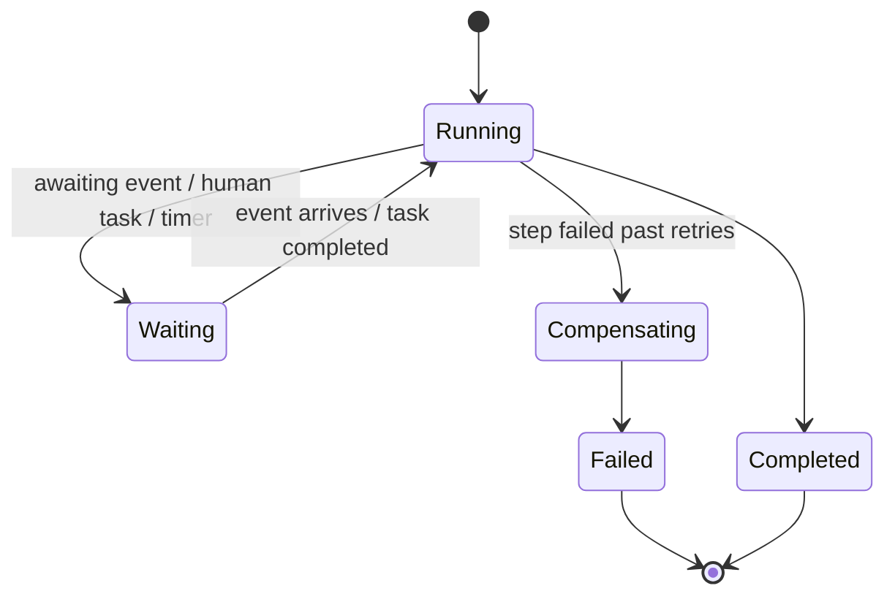
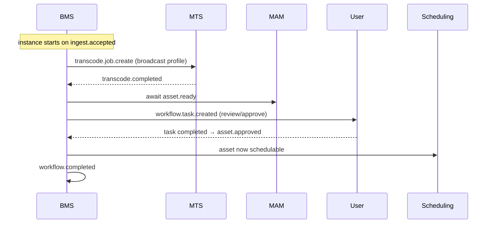

# BMS — Business Process Management System (Workflow Engine) — Service Specification

> Authors and executes configurable workflows that orchestrate the other services and human
> steps. Summary card:
> [Service Catalog §BMS](../03-service-catalog.md#bms--business-process-management-system).
> Template: [services/README](README.md#spec-template).

## 1. Purpose & boundaries

BMS is the **orchestrator**. Where most flows are choreographed (services react to events), BMS
runs the multi-step **business flows operators author** — the ones that need visibility,
retries, timeouts, and **human-in-the-loop** steps (approval, task assignment). It ships preset
flows (the canonical ingest-to-air), lets operators duplicate/modify/author flows per
category/type/usage in a **visual drag-and-drop designer in Studio**, and shows each asset's
position in its flow.

**Editor vs. engine — the key split.** A flow is **data**: a versioned **workflow definition**
(JSON graph of steps + connections). The Studio **designer edits that definition**; the durable
**engine executes a compiled form of it**. The two never share code — the same definition drives
both, so a new flow needs no deploy ([FR-BMS-7](../../requirements/05-functional-requirements.md#workflow)).

**In scope:** workflow **definitions** (authoring, versioning, publish, **validation**); the
**visual designer** contract (palette, definition schema); **BPMN 2.0 export/import** of
definitions ([FR-BMS-10](../../requirements/05-functional-requirements.md#workflow)); a durable
**execution engine** (issue commands, await events, retries/timeouts, compensations); human steps
(approval/tasks); SLA timers; flow-instance visibility.

**Out of scope:** the work itself (BMS commands MTS/HSM/etc., it doesn't transcode or move
files); the task **inbox/UI** ([Notifications](notifications.md) delivers tasks BMS creates);
approval **policy** on the asset record ([MAM](mam.md) holds lifecycle state). The **manual
path can bypass BMS** — automated flows are its domain.

## 2. Requirements covered

- [FR-BMS-1…9](../../requirements/05-functional-requirements.md#workflow) — preset flows incl.
  the canonical ingest-to-air; duplicate/modify; author new scoped flows; orchestrate via
  commands+events with retries/timeouts; human-in-the-loop steps; show current position;
  **visual drag-and-drop designer** (FR-BMS-7) with a **step palette** (FR-BMS-8) and
  **validation + immutable versioning on publish** (FR-BMS-9).
- Drives [FR-APP-1/2](../../requirements/05-functional-requirements.md#approval) (review →
  task → approval) and [FR-PLat-4](../../requirements/05-functional-requirements.md#platform)
  (flows configurable without a deploy).
- NFR: [NFR-MNT-2](../../requirements/06-non-functional-requirements.md#maintainability)
  (versioned contracts), reliability of long-running orchestration.

## 3. Domain model

| Entity | Key fields | Store |
|--------|-----------|-------|
| **WorkflowDefinition** | id, channelId, scope (category/type/usage), version, steps[], published | Relational |
| **Step** | id, kind (command/wait-event/human-task/timer/branch), config, retry/timeout, compensation | Relational (in def) |
| **WorkflowInstance** | id, defId+version, assetId, state, currentStep, vars, startedAt | Relational + durable timers |
| **HumanTask** | id, instanceId, assignee, kind (approve/edit), state, dueAt | Relational (mirrors to Notifications) |
| **StepHistory** | instanceId, step, event, at, result | Relational (audit/visibility) |

Instances are **pinned to the definition version** they started on, so editing a flow never
corrupts running instances.

### 3.1 Instance state



### 3.2 Definition = designer model

> **Deep dive:** the full model, step-kind catalog, FEEL, validator, Temporal interpreter, BPMN
> converter and canvas architecture are specified in
> [BMS Workflow DSL, Designer, Engine & BPMN Converter](../bms-workflow-dsl-and-designer.md);
> machine-readable contract: [`workflow-definition.schema.json`](../schemas/workflow-definition.schema.json).

The `WorkflowDefinition` is a **directed graph** — the exact thing the Studio canvas manipulates.
One schema (published in the shared `contracts` package) serves editor, storage, and engine:

| Designer concept | Definition | Runtime meaning |
|------------------|-----------|-----------------|
| **Node on canvas** | `Step { id, kind, config, position, retry/timeout, compensation }` | an activity/wait the engine runs |
| **Palette kinds** ([FR-BMS-8](../../requirements/05-functional-requirements.md#workflow)) | `command` (service action) · `wait-event` · `human-task` (assign/approve) · `timer` · `branch` (condition) · `parallel` (split/join) · `sub-flow` | how the step executes |
| **Edge** | `transitions[] { from, to, when? }` | control flow / branch conditions |
| **Canvas variables/mapping** | `vars`, per-step input/output binding | data passed between steps |

`position` (canvas x/y) is **presentation-only** metadata the engine ignores — so layout
round-trips without affecting execution. **Validation** ([FR-BMS-9](../../requirements/05-functional-requirements.md#workflow))
runs on the definition (reachability, no dangling edges, bound references, type-correct
connections) before publish; **publish freezes an immutable version** and running instances stay
pinned to theirs.

### 3.3 BPMN 2.0 alignment & interop

**Decision:** the internal model is our **own JSON DSL**, but its step kinds are a **curated
subset of BPMN element types**, so a definition is **losslessly convertible to/from BPMN 2.0**
([FR-BMS-10](../../requirements/05-functional-requirements.md#workflow)) — keeping the system
modular and interoperable with standard BPMN tooling. The mapping is deterministic:

| DSL step `kind` | BPMN 2.0 element |
|-----------------|------------------|
| start / end (endpoints) | Start Event / End Event |
| `command` (service action) | **Service Task** |
| `human-task` (assign / approve) | **User Task** |
| `wait-event` | Message/Signal **Intermediate Catch Event** |
| `timer` | **Timer** Intermediate/Boundary Event |
| `branch` (condition) | **Exclusive (XOR) Gateway** |
| `parallel` (split/join) | **Parallel (AND) Gateway** |
| `sub-flow` | **Call Activity / Sub-Process** |
| `transitions[] { from, to, when? }` | **Sequence Flow** (+ `conditionExpression`) |
| `compensation` | Boundary **Error/Compensation Event** |
| retry/timeout/SLA, var mapping | BPMN **extension elements** (namespaced) |
| `position` (canvas x/y) | **BPMN DI** (`BPMNShape` / `BPMNEdge`) |

Engine-specific policy that has no native BPMN control-flow (retry/backoff, SLA, data binding)
rides in **namespaced extension elements** — the same technique Camunda/Zeebe use — so a standard
BPMN tool still imports the diagram, and Atlas round-trips the full fidelity. Layout maps to
**BPMN DI**, so Foblex Flow node positions survive export/import. The converter is a pure library
in `contracts`; [bpmn-js](https://bpmn.io/toolkit/bpmn-js/) may be used to serialize/parse the
BPMN XML.

## 4. Public API

> **Contracts:** REST → [OpenAPI stub](../openapi/bms.yaml) · events → [payload schemas](../schemas/).

| Method | Path | Purpose | Authz |
|--------|------|---------|-------|
| `GET/POST/PATCH` | `/workflows` | Definition CRUD (authoring) — the designer reads/writes this. | `workflow:admin` |
| `GET` | `/workflows/palette` | Step kinds + their config schemas (drives the designer palette + property panels). | `workflow:admin` |
| `POST` | `/workflows/{id}/validate` | Validate a draft graph without publishing (live designer feedback). | `workflow:admin` |
| `POST` | `/workflows/{id}/publish` | Validate + publish a new immutable definition version. | `workflow:admin` |
| `GET` | `/workflows/{id}/export?format=bpmn` | Export the definition as **BPMN 2.0** XML (with DI layout). | `workflow:admin` |
| `POST` | `/workflows/import` | Import a **BPMN 2.0** file → a draft definition (validated). | `workflow:admin` |
| `GET` | `/instances`, `/instances/{id}` | Running flow state + position. | `workflow:read` |
| `POST` | `/instances/{id}/signal` | External signal (e.g. human task done). | service/`workflow:act` |
| `POST` | `/tasks/{id}/complete` | Complete a human-in-the-loop step. | task assignee |

## 5. Messaging

- **Emits:** `workflow.step.requested` (the observable record that a step is due; a **command**
  step is carried out by issuing the target service's own command, e.g. a transcode step issues
  `transcode.job.create`), `workflow.task.created` (→ Notifications, a human step),
  `workflow.completed`.
- **Consumes:** the **completion events of every service it orchestrates** — `ingest.accepted`,
  `transcode.completed`/`failed`, `asset.ready`/`approved`/`rejected`, `restore.completed`,
  `schedule.sent-to-air`, etc. — to advance waiting instances. As built (§13d): the answers to the
  commands in `WORKFLOW_COMMANDS`, matched by correlation id (`transcode.completed`/`failed`);
  Notifications' `task.updated` (§13e); and the events a step may WAIT for, `WORKFLOW_EVENTS`
  (`asset.ready`/`approved`/`rejected`), matched by keys (§13f). Emits `workflow.task.resolved`
  when a review's verdict closes its task (§13f).

See [Messaging §Workflow/scheduling](../04-messaging-and-data.md#workflow--scheduling--people).

## 6. Key flows

### 6.1 Canonical ingest-to-air (preset)



### 6.2 Retries, timeouts, compensation
Each step carries retry/backoff and a timeout; a step that exhausts retries triggers a
**compensation** path (e.g. mark asset rejected, notify) rather than hanging. Durable timers
survive restarts — a wait step resumes exactly where it paused.

### 6.3 Authoring in the visual designer

```mermaid
sequenceDiagram
    participant User as Operator (Studio)
    participant Canvas as Designer (Foblex Flow)
    participant BMS
    participant Engine as Durable engine
    Canvas->>BMS: GET /workflows/palette (step kinds + config schemas)
    User->>Canvas: drag steps, connect edges, set properties
    Canvas->>BMS: POST /workflows/{id}/validate (draft graph)
    BMS-->>Canvas: errors/warnings (unreachable, unbound, bad edge)
    User->>Canvas: Publish
    Canvas->>BMS: POST /workflows/{id}/publish
    BMS->>BMS: validate → freeze immutable version N
    BMS->>Engine: register/compile definition vN (interpreter)
    Note over Engine: new instances start on vN; running ones stay pinned
```

The canvas is **thin**: it renders the `WorkflowDefinition` graph, edits it against the palette's
config schemas, and calls validate/publish (and export/import BPMN). **All semantics live in the
definition + engine**, not the editor — so swapping the canvas library or adding a step kind never
touches execution. **Live instance overlay:** the same graph, colored by `StepHistory`, powers the
"where is this asset in its flow" view ([FR-BMS-6](../../requirements/05-functional-requirements.md#workflow)).

## 7. Dependencies

- **Durable workflow runtime** (Temporal via its TypeScript SDK — [ADR-0010](../../adr/0010-bms-durable-runtime.md)) for
  timers/retries/state.
- **Every orchestrated service** (via events/commands), **Notifications** (tasks),
  **relational store**, **broker**.

## 8. Scaling & performance

- **Stateful engine**, scaled by **partitioning instances** (e.g. by `assetId`/`channelId`).
- Throughput is orchestration overhead, not heavy compute — Node fits; the durable runtime
  handles persistence/timers.
- Critical path for **automated** flows; the manual path can proceed if BMS is degraded.

## 9. Failure modes & degradation

| Failure | Effect | Mitigation |
|---------|--------|-----------|
| BMS down | Automated flows pause | Durable state; instances resume on recovery; manual path unaffected. |
| Orchestrated service fails a step | Step retries then compensates | Retry/backoff + compensation; DLQ + alert. |
| Duplicate completion event | Risk of double-advance | Idempotent step handling keyed on instance+step+messageId. |
| Definition edited mid-flight | — | Running instances stay on their pinned version. |

## 10. Security & data sensitivity

- Authoring is privileged (`workflow:admin`); publishing a flow is audited.
- Human tasks route only to permitted assignees; task actions are audited (who approved what).
- BMS holds no media/PII — it references assets and users by id.

## 11. Configuration

Preset flows shipped as defaults; per-channel/type/usage flow definitions authored without a
deploy ([FR-PLat-4](../../requirements/05-functional-requirements.md#platform)); step
retry/timeout/compensation policies; SLA timers; task-assignment rules.

## 12. Observability

- **Metrics:** running/waiting/failed instances, step latency, retry/compensation rates, SLA
  breaches, task age.
- **Logs:** step history (the visibility feature) — every transition with cause.
- **Traces:** instance correlation id across all orchestrated service calls.

## 13. Implementation notes

- **Node.js + NestJS** for authoring/visibility APIs; **Temporal (TypeScript SDK)** for durable
  execution keeps orchestration **in-language** ([ADR-0010](../../adr/0010-bms-durable-runtime.md); the
  broker-backed saga stays a fallback behind `Effects`). Definitions are data (JSON/DSL), interpreted by the engine, so new flows need no
  deploy.
- Keep step handlers idempotent and side-effect-guarded.
- **Designer canvas (Studio, Angular): [Foblex Flow](https://flow.foblex.com/)** (`@foblex/flow`,
  MIT) — Angular-native, signals-based, built for workflow builders (drag-to-connect, minimap,
  snapping, waypoints). Keep it **thin over our definition schema**; all semantics stay in the
  definition + engine so the library remains swappable. *(The MIT npm package is what ships; full
  source is a separate paid license.)*
- **Definition format: own JSON DSL, BPMN-aligned (decided).** The DSL is the internal model
  (ergonomic for the canvas + a clean Temporal mapping); a pure **converter** in `contracts` does
  lossless **BPMN 2.0** export/import (§3.3), with [bpmn-js](https://bpmn.io/toolkit/bpmn-js/) for
  XML/DI serialization. Design the DSL step kinds as a **BPMN subset from day one** so the mapping
  stays deterministic.

## 13a. As built — EP-22.2, workflow definitions

`apps/bms`, generated (`nx g service bms --db --broker`), serving the authoring half of
[`bms.yaml`](../openapi/bms.yaml) through the gateway (`/api/v1/workflows`, and `/api/v1/instances`
routed ahead of EP-22.3):

- **A header and its versions** (DSL doc §7): `workflows` (compare-and-set on `revision`) and
  `workflow_versions` — both carrying `channel_id`. Version n is the one open draft
  (`latestVersion + 1`, a partial unique index holds "at most one") or published, and a published
  row is never written again: the upsert's `WHERE status = 'draft'` matches nothing, in both
  adapters, held by one conformance suite on sqlite and Postgres.
- **A draft saves whatever it holds** — work in progress; `POST …/validate` gives the designer the
  publish rules on demand (the body's graph, or the stored draft's), and **publish is the gate**: the
  `workflow-definition` schema, the graph rules (§6), every expression inside the restricted FEEL
  subset (`@atlas/contracts/workflow`), and — what only the store knows — a sub-flow must name a
  published workflow of the same channel. Refused, it is a 422 whose `details.issues` are the
  issues; the draft stays a draft. Warnings ride along on the publish result.
- **Every write** (create, save, publish) commits `audit.recorded` with the field-level delta in
  its transaction; the history is readable under `workflow:read` (+ `logs:read`), the default rule.
- **Authorization:** reading takes `workflow:read` or `workflow:admin` (who authors a flow reads
  it); every write takes `workflow:admin`; another channel's workflow is not found.
- **Not here — human tasks.** `bms.yaml` no longer declares `/tasks/{id}/complete`: a workflow's
  task is Notifications' (`/tasks`, notifications.md §6.2) and its completion signals the waiting
  instance (EP-25.8), so the prefix has one owner.
- Smoke authors the canonical preset through the gateway, is refused publish while a transition
  holds a FEEL loop, publishes it fixed, and reads the four audit revisions back.

## 13b. As built — EP-22.3, the runtime

**Temporal in the cluster** ([ADR-0010](../../adr/0010-bms-durable-runtime.md); its four checks
are the evidence): `infra/k8s/base/temporal.yaml`, and so the chart (`temporal.enabled`/`host`/`port`,
images under `images.temporal` and `images.temporal-admin-tools`). Its state is in
`temporal`/`temporal_visibility` on the platform's Postgres, migrated by its schema initContainer on
every start. **BMS's image is `node:24-slim`** (the SDK's native core is glibc-only), the only image
built with `BASE_IMAGE`, and the only one carrying the SDK: the Dockerfile installs ONE workspace's
dependencies (`npm ci --workspace`), and BMS's build keeps only the linux core of the five the SDK
ships.

**The worker runs in BMS** (`src/temporal/`): one generic workflow (`atlasWorkflow`) runs every
definition — the published definition is its argument, so an instance is pinned to its version — by
handing the interpreter (`src/engine/`, lifted from `reference/bms-workflow`) an `Effects` made of
Temporal primitives: durable timers, `condition` over an inbox filled by the `step` signal, child
workflows for sub-flows, and five activities. The workflow code is bundled at IMAGE build
(`apps/bms/bundle.mjs`, run by the Dockerfile); without the bundle — a laptop, a test — the worker
bundles from source. BMS ensures its namespace (`atlas`) at start-up, connects to Temporal in the
background (authoring needs no runtime; starting an instance is a 503 until it is connected) and
exits if the worker dies.

**Every activity is idempotent** (`src/runtime.ts`), because Temporal runs one again after a crash:
a history entry is keyed by the instance's own sequence number; every other write commits behind a
deterministic key in the seen-mark table in its transaction; a task or a child instance is named by a
ULID DERIVED from the instance and the key, so a retry names the same one.

| Activity | Writes |
|---|---|
| `recordHistory` | `workflow_step_history` (instance, seq) and the mirror's state / `currentSteps` |
| `requestStep` | the target's own command, `workflow.step.requested` and the await row (EP-22.4, §13d) |
| `createTask` | `workflow.task.created` — Notifications materializes it (EP-25) |
| `prepareChild` | the sub-flow's instance row + its audit |
| `finish` | the mirror's terminal state, `workflow.completed`, `audit.recorded` |

**Instances** (`bms.yaml`): `POST /instances` starts a PUBLISHED version (`workflow:act`) — the
mirror row and its audit commit first, then Temporal is asked; if it cannot be, the row says the
instance never ran (`failed`, with why) and the caller gets a 503, never a `running` row nobody
runs. `GET /instances[/{id}]` lists and reads (any workflow grant), the single read with its step
history (FR-BMS-6). `POST /instances/{id}/signal {stepId, payload}` delivers a completion or an
event to a waiting step (kept if the step is not waiting yet) — the generic path until EP-22.4's
router delivers completions from the bus. An escalation is recorded in the history; notifying anyone
is EP-25's.

Evidence on kind: smoke runs an instance through a durable timer, a wait and a signal; the **crash
test** (`npm run crash:bms`, the Smoke workflow's last step) force-kills the Temporal server and the
BMS pod while an instance is inside a timer — both back in 18 s, the timer fires, the instance ends
with a gapless history; the **restore drill** leaves an instance waiting, restores, and finishes it.
CI runs the worker against Temporal's dev server (`apps/bms/test/temporal.test.ts`).

## 13c. Workflow lifecycle and the catalog (EP-22.11, decided 2026-10-13)

| State | In the catalog | Starts instances | Reached by |
|---|---|---|---|
| `draft` | no | no | creating it; it stays a draft until its first publish |
| `active` | **yes** | **yes** | the first publish; `POST …/activate` from inactive |
| `inactive` | no | no | `POST …/deactivate` — can be reactivated |
| `archived` | no | no | `POST …/archive` from any state — **final**, kept for its history |

- **Deactivating and archiving are REFUSED while any instance of the workflow is still running or
  waiting** (409, `details.running`). Both count the live instances under the workflow header's row
  lock, and starting an instance takes the same lock to check the state — so the two cannot
  interleave into an instance running on an inactive workflow (a conformance case races them on
  Postgres). Running instances are never cancelled by a state change.
- A later publish leaves the state alone: a new version of an inactive workflow does not reactivate
  it. An archived workflow cannot be edited or published. A sub-flow must name an ACTIVE workflow —
  at publish (`SUBFLOW_INACTIVE`) and when the child starts (a non-retryable refusal: the step fails).
- **The catalog** — `GET /workflows/catalog` — is every active workflow of the channel with the
  published definition a new instance runs. **Every authenticated user** reads it, with no workflow
  permission: an active workflow is visible to everyone in its channel. A client loads it at sign-in
  and keeps it; it is ETag'd (each entry's id and revision), so an unchanged re-fetch is a 304. Drafts
  and inactive or archived workflows stay behind `workflow:read`/`:admin` (`GET /workflows?state=`).
- **`workflow.changed`** (`published` / `activated` / `deactivated` / `archived`, with the state,
  latest version and revision after it) is emitted in the transaction of every change to the
  catalog, for every client to refetch or drop what changed. Saving a draft emits nothing.
- **Change logs** — a workflow's and its instances' audit history, and `workflow.*` entries in the
  log — are read under a dedicated `workflow:audit` permission. `workflow.changed` reaches every
  user of the channel over the socket (the WebSocket service's channel-wide set, after tenant
  isolation). Both were reviewed and merged (#518, 2026-10-15), with the Administrator starter role
  holding every permission (`*:*`).

## 13d. As built — EP-22.4, command steps and the completion router

**A command step issues the target service's OWN command** — today `transcode.job.create` to MTS.
The commands a workflow may issue are a closed, Tier-0 list in the contracts both sides read
(`WORKFLOW_COMMANDS`, `@atlas/contracts/workflow`), each with the events that answer it:

| Command | Target | Completes the step | Fails the step |
|---|---|---|---|
| `transcode.job.create` | mts | `transcode.completed` | `transcode.failed` |

Closed because BMS publishes with the platform's authority: a workflow author with `workflow:admin`
must not be able to make it publish a FACT another service believes (`asset.approved`,
`permissions.changed`), nor a command nobody consumes, whose step would wait forever. Adding one is a
code change on both sides — the target consumes it and answers it under the command's correlation id.

**Publish refuses** (DSL doc §6): `UNKNOWN_COMMAND` (not in the list), `COMMAND_INPUT` (an input key
that is not a field of the command's payload schema, or a required field missing — the values are
FEEL and known only at run time, the keys are not), `AWAIT_EVENT` (an awaited event that does not
answer the command) and `CORRELATE_UNSUPPORTED` (`await.correlate` — the answer is matched by
correlation id; matching on an expression is the event fan-out wait-event steps get with EP-22.6). A
dotted input key builds a nested field (`"inputFile.kind": "= \"original\""`), since the FEEL subset
has no context literal. The presets moved with it: the canonical preset's transcode step is now a
valid command (`presetIds`, the original in HSM); `simple-approval` no longer publishes to the web;
`post-approval-distribution` stays unpublishable until EP-37 adds the publishing commands.

**Issuing** (`requestStep`, one transaction through the outbox): the command,
`workflow.step.requested` (`target`; `params` with the command, its input and correlation id) and a
row in `command_awaits`. The command's envelope carries a correlation id DERIVED from the instance and
the activity's key — a retried activity names the same command, and every visit of a step (a retry, a
loop) a new one — and the activity returns it, so the workflow takes only THAT command's answer: a
late answer to an earlier attempt is not the current attempt's (`StepInbox`, shared by the Temporal
workflow and the in-process runner). The payload is validated against the command's schema at run
time too; a refusal fails the step without retrying the activity.

**The completion router** (`src/router.ts`) is a durable consumer of every answer type
(`atlas.*.transcode.completed`, `atlas.*.transcode.failed`). It looks the answer's correlation id up
in `command_awaits` — most events of those types are nobody's (MTS's own first renditions, a person's
transcode) and are acknowledged untouched, as is one from another channel — and signals the waiting
step with the answer (`{ stepId, correlationId, payload }`, plus `error` for a failure, which fails
the step so its retries and `onError` take over instead of its timeout). The signal goes first and
the await is then marked answered by a conditional update: a redelivery is a duplicate, an answer to
an ended instance is `orphaned` (Temporal has nothing to signal), and a crash between the two re-sends
a signal the instance already matched — harmless. The step's history and the instance's error carry
the target's words (`workflow failed at "s_tx": COMMAND_REFUSED: unknown preset(s): …`).

**A command step carries its PUBLISHER's authority** (decided 2026-10-16; authorization-model
§8.1). BMS issues the command as itself and MTS's broker path trusts its issuer, so without a check a
person allowed only to start a workflow could have MTS rewrite any asset's renditions. Each command
declares the authority it exercises (`requires` — transcode: `asset:write` on `files`), and
**publishing or activating** a workflow is refused (403, naming the step) unless the caller holds all
of them channel-wide, strictly — a category-narrowed grant does not vouch, since an instance may run
on any asset of the channel. Starting it then needs only `workflow:act`. A grant revoked later does
not reach into an already published version; deactivating the workflow does.

**MTS answers a refusal** (mts.md §5): a well-formed command it cannot honour is answered
`transcode.failed` (`COMMAND_REFUSED`) at once under the command's correlation id, rather than retried
into the dead-letter queue while the issuing step waited out its timeout. And it takes `inputFile`
(the asset's file in HSM) over the broker, as over HTTP — how a workflow names an input.

Evidence: `test/router.test.ts` (end to end through the in-process runner — the answer, a failure and
the retry's new command, the late answer, ignored/duplicate/orphaned), the conformance suite on sqlite
and Postgres, `test/temporal.test.ts` on a real Temporal (a refusal, the retry, the answer, an orphan),
and smoke on kind: a workflow transcodes an uploaded asset's original through MTS and ends with MTS's
rendition in its vars; one asking for an unknown preset fails with MTS's words.

Found on the way: the worker loaded `dist/workflow-bundle.js` whenever it existed, so on a laptop a
bundle left by an earlier `bundle.mjs` ran THAT day's workflow code against today's activities —
every test against a local Temporal tested the wrong workflow, and passed. It now uses the bundle only
when it is newer than every BMS source file (always, in the image) and bundles from source otherwise.
And an activity's refusal reached the workflow as Temporal's `ActivityFailure` ("Activity task
failed"); the workflow unwraps it, so the history says what was refused.

## 13e. As built — EP-22.5 / EP-25.8, the human step

A human step creates its task — `workflow.task.created`, to a user or a ROLE (`assigneeKind`), with a
task id DERIVED from the instance and the activity — and records an await row keyed by that id in the
same transaction (`command_awaits`, `command: workflow.task.created`). Notifications materializes the
task; a holder claims it and completes it there (notifications.md §13c). The completion router also
consumes `task.updated` (`atlas.*.task.updated`): a `done` for a task BMS made signals the waiting
step with `{ outcome, by, taskId }` — what a human step's `output` maps from (`= incoming.outcome`) —
then marks the await answered once. A claim or a forward is not a completion; another channel's update
and a task assigned by hand (no await) are ignored; a redelivery is a duplicate; an ended instance's
is orphaned. The workflow takes only ITS task's completion (`StepInbox.expect` with the task id); a
person's uncorrelated signal (`POST /instances/{id}/signal`) still completes the step, as before.

A workflow's task is never cancelled by hand (Notifications refuses it); ending a waiting human step
other than by completing its task — a timeout, an escalation's outcome — is EP-22.9's.

Smoke: a workflow offers its human step to a role the smoke user holds through a group; the user
finds it in the inbox, claims it, completes it — and the instance completes with nobody signalling it.

## 13f. As built — EP-22.6, waiting for events, and the review step (decided 2026-10-16)

**A step may wait for an event nobody sent BMS as an answer** — a wait-event step, or a review step
waiting for MAM's verdict. No correlation id comes back with such an event, so the step is found by
its KEYS:

- **What may be waited for is closed** — `WORKFLOW_EVENTS` (`@atlas/contracts/workflow`):
  `asset.ready`, `asset.approved`, `asset.rejected`. Publish refuses any other (`UNKNOWN_EVENT`): an
  author may not make BMS consume, and copy into vars, whatever passes on the bus, and the router
  keeps one durable per listed type — a type nobody consumes would strand its step.
- **`correlate` is equality keys** — `incoming.<field> = <expr>`, joined with `and`, the `<expr>` not
  reading `incoming` (`CORRELATE_SHAPE`), on fields the event has (`CORRELATE_FIELD`) —
  `@atlas/contracts/workflow-correlate`, a subpath that loads in Temporal's sandbox. The workflow
  evaluates each `<expr>` when the step starts waiting, and an activity (`awaitEvent`) records the
  resulting `match` as a row of `event_awaits` under a derived correlation id the step then expects.
- **The router** (`routeEvent`) reads the OPEN awaits of the event's type in its channel — narrowed by
  the event's `assetId` to rows keyed on that asset or on none (an indexed column) — compares their
  keys with the payload, signals every match, and answers each row once. A redelivery finds nothing
  open. A key that evaluated to `null` matches nothing.

**A review step** is a human step with a `reviewPointId` (publish holds it to `taskType: approve`,
`REVIEW_TASK_TYPE`, and one step per point, `DUP_REVIEW_POINT`). Decided with the product owner:

1. **MAM's verdict moves the workflow, not the task.** `createTask` records, in the task's
   transaction, an event await per verdict (`asset.approved`, `asset.rejected`) keyed on the
   instance's asset, under the TASK's id — so the verdict reaches the step as its task's outcome
   (`{ outcome, by, taskId, assetId, reviewPointId?, reason?, expiresAt? }`; `= incoming.outcome`
   maps it). The router then answers both verdict rows and the task's own await, and emits
   `workflow.task.resolved` in the same transaction; Notifications closes the task with it (its
   `task.updated` reaches BMS as a duplicate). Notifications refuses to complete a review task by
   hand (409): a "done: approved" there would move the workflow past an asset MAM never approved.
   An instance with no asset fails at the step, naming why.
2. **A verdict naming the step's point, or naming none, resolves it**; one naming another point does
   not. A verdict given straight from the asset editor still decides the asset, and MAM refuses a
   second one — a strict match would strand the workflow.
3. MAM carries the point on the verdict's event: `POST /assets/{id}/approve` and `/reject` take
   `reviewPointId` (mam.md §4), and `asset.approved`/`asset.rejected` say it.

An event published before its step starts waiting is taken from the buffer since EP-22.7 (§13g);
ending a waiting step by its timeout is EP-22.9's (§13h). Several review points on one asset meet MAM's lifecycle (`approved` cannot be approved
again), so multi-point flows of real use are EP-24.7's.

Evidence: `libs/contracts/test/workflow.test.ts` (the keys, the publish rules), `test/review.test.ts`
(end to end through the in-process runner: keys, channel, asset, every waiting instance, a two-point
review with a verdict at each, an unnamed verdict, no asset, an orphan), the store conformance case
on sqlite and Postgres, `test/temporal.test.ts` on a real Temporal (a wait-event then a review
resolved by a verdict), and smoke on kind: an instance waits for `asset.ready`, its review task is in
the inbox naming its point, completing it by hand is refused, the approval in MAM at that point
completes the instance with `approved` and closes the task.

## 13g. As built — EP-22.7, triggers, the event buffer, and the canonical preset (decided 2026-10-17)

**A start trigger starts workflows.** A start step's `trigger.event` is one of a CLOSED list —
`WORKFLOW_TRIGGERS`, today `ingest.accepted` (publish refuses any other, `UNKNOWN_TRIGGER`;
`asset.expired` joins with EP-22.10, `asset.approved` with EP-37). BMS keeps one durable per trigger
(`src/trigger.ts`): each event starts every ACTIVE workflow of its channel whose start names it and
whose `trigger.filter` (FEEL over `incoming`, the event's payload) is true — once per event, the
instance id DERIVED from the message and the workflow, so a redelivery inserts nothing and asks the
runtime again (which starts an id once). The instance runs as BMS (`startedBy: bms`,
`triggeredBy: { event, messageId }`) on its publisher's authority (§13d), with the event as the start
step's `incoming`; `trigger.output` maps it into vars (a start through the API gives its vars
itself, so the mapping is the trigger's only); the event's `assetId` is the instance's. The header's
lock is taken as for a person's start, so an instance is never started on a workflow deactivated
meanwhile. The runtime away goes back to the broker: the row is written, the start is retried.

**Waitable events are buffered** (decided with the product owner). The router keeps every
`WORKFLOW_EVENTS` event it consumes in `event_buffer` (by type, channel and asset; pruned hourly
after `EVENT_BUFFER_DAYS` = 7) BEFORE it reads the open awaits; a step registers its await BEFORE it
reads the buffer — so of the two, at least one sees the other. A step that starts waiting — a
wait-event, or a review step's verdict awaits — takes the EARLIEST matching event that occurred since
ITS INSTANCE STARTED, answering the await by the same once-only update the router uses (whoever loses
that update delivers nothing). An event moves an instance at most ONCE: one that already answered an
await of the instance is not taken again, so a verdict that resolved one review point does not
resolve the next. This is what makes the canonical preset hold in normal use — an editor marks the
asset ready while the broadcast transcode runs; MAM approves at ready a category that needs no
review — and it covers a review step reached after its verdict.

**A wait-event registers before it records `awaiting`** (`Effects.awaitEvent`, then
`waitForEvent`), as a command is issued and a task created before theirs: a mirror that says an
instance waits in a step means the router can find it.

**The canonical preset** (`canonical-ingest-to-air.workflow.json`) runs end to end: an upload's
`ingest.accepted` starts it; it has MTS make the broadcast rendition from HSM's original; it waits for
`asset.ready`; its review at `pre-schedule` is resolved by the approval in MAM; it ends at
`s_end_ok` (`status: approved`) — schedulable, since Scheduling keeps its own record of MAM's
approvals (EP-31) — or at `s_end_rej` on a rejection. Its escalation is recorded, not sent (EP-25).

Evidence: `test/trigger.test.ts` (once per event and per workflow, the filter, another channel, an
inactive workflow, the buffer since the start and not before, a verdict before the step, an event
used once, the preset approved and rejected), the buffer's conformance case on sqlite and Postgres,
`test/temporal.test.ts` on a real Temporal (the preset started by its trigger, its ready taken from
the buffer), and smoke on kind: a real upload starts a published copy of the preset, MTS transcodes
broadcast, the asset is made ready while that runs, and the approval ends the instance at `s_end_ok`
with the broadcast rendition in its vars.

## 13h. As built — EP-22.9, timeouts, error paths and failed runs (decided 2026-10-17)

- **A waiting step's timeout goes to its `onError`** — a human step or a wait-event, like a command
  that has exhausted its retries: `{ transitionTo }` takes the error path, `compensate` runs the
  compensations in reverse, `fail` (the default) fails the run. Any failure of the step does the
  same (a review step on an instance with no asset, say). **`retry` is a command's only**: publish
  refuses it on any other kind (`RETRY_NOT_COMMAND`) — re-asking a person, or waiting again, is
  the author's own loop. An error path and a compensation handler count as reachable for the
  graph check, which called them unreachable until now.
- **A task nobody is to work on is CANCELLED.** A human step that times out, and every task still
  open when its run fails (another branch's failure, say), is closed by `closeAwait` in one
  transaction: its awaits answered (`closed:<reason>`) so a late completion or verdict moves
  nothing, and `workflow.task.resolved` with `state: cancelled` and `reason: timeout |
  workflow-ended`, which Notifications applies (notifications.md §13c). Once only: a task completed
  or resolved first stays as it ended, and nothing is cancelled. A wait-event that times out has
  its wait closed the same way.
- **A run nothing catches is raised to operations**: `finish` emits `alert.raised` (`source: bms`,
  `kind: workflow-failed`, `warning`, the instance as `subjectRef`; read in the log under
  `ops:read`) in the transaction of the failure, `atlas_bms_instances_failed_total` counts it, and
  `GET /instances?state=failed` is the operator's list. No automatic restart.

Evidence: `test/timeouts.test.ts` (a timed-out review taking its error path, its task cancelled and a
late verdict and `done` both moving nothing; a timed-out wait failing the run, alerted, listed,
its wait closed; a task cancelled when another branch fails the run; `RETRY_NOT_COMMAND`),
`test/temporal.test.ts` on a real Temporal (a timeout inside the sandbox takes its error path and
cancels the task), Notifications' test for the cancelled form, and smoke on kind: a review out of
time ends at its error path and leaves the inbox; a lost wait fails and is in the failed list.

## 14. Open questions / future

- **Decided:** Studio gets a **visual drag-and-drop designer** ([Foblex Flow](https://flow.foblex.com/))
  over an **own JSON DSL** that is **losslessly convertible to BPMN 2.0** (§3.3) for tool interop.
- Sub-workflows / reusable flow fragments and a shared step library.
- Whether Temporal is adopted platform-wide (also useful for HSM restore sagas).
- How far to expose expressions/conditions in the designer (safe expression language vs. free code)
  — and how those serialize into BPMN `conditionExpression`.

---
_Related: [MTS](mts.md) · [MAM](mam.md) · [Notifications & Messaging](notifications.md) ·
[Brief §5 canonical flow](../../01-technical-brief.md#5-canonical-end-to-end-flow)._
