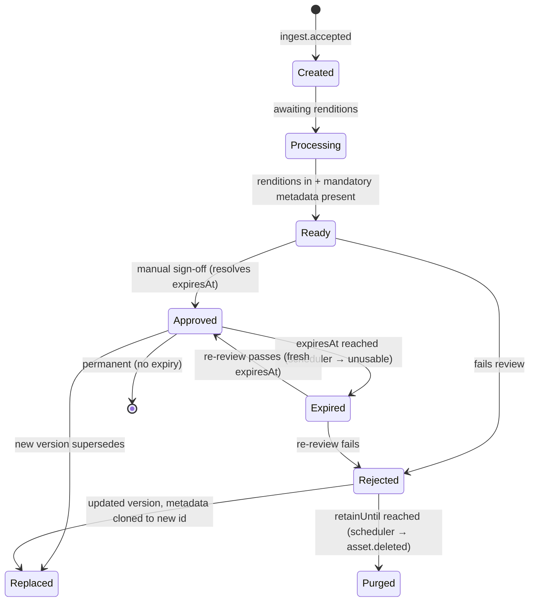

# MAM — Metadata & Asset Management — Service Specification

> System of record for media metadata and the searchable catalog — the busiest domain service.
> Summary card: [Service Catalog §MAM](../03-service-catalog.md#mam--mediametadata--asset-management).
> Template: [services/README](README.md#spec-template).

## 1. Purpose & boundaries

MAM is the **system of record for what an asset is**: its core and extensible metadata, its
renditions' logical references, its classification (tags, categories, subjects), the people
associated with it, and its lifecycle state (created → ready → approved, with **time-bounded
approval** and **rejected-retention** handled by an internal scheduler). It projects all of
this into a **search index** and fronts hot reads with a **cache**. Physical bytes belong to
[HSM](hsm.md); MAM holds the meaning and the catalog.

**In scope:** core metadata (relational); extensible type/category fields (document); field-
schema definitions; versioning + metadata cloning on replacement; tags/categories/subjects and
their controlled vocabularies; **category-inherited media expiry** and the **scheduler** that
expires approvals (→ re-review) and purges retention-expired rejects; the review-verdict record
(with retained history); the **people/cast register**; simple + advanced **faceted** search; the
metadata cache; asset lifecycle events.

**Out of scope:** file location/integrity ([HSM](hsm.md)); encoding ([MTS](mts.md)); who may
see what beyond storing owner/department for authz (enforced with [IAM](iam.md) rules); workflow
orchestration ([BMS](bms.md)); AI inference ([AI](ai-enrichment.md) — MAM records its
*suggestions/results*).

## 2. Requirements covered

- [FR-MAM-1…8](../../requirements/05-functional-requirements.md#mam) — core fields; extensible
  fields + schema editor; tags/description/shot-list; simple + advanced search; mandatory-
  metadata gate; versioning + clone-on-replace; cached reads; derived-vs-entered provenance.
- [FR-TAX-1…6](../../requirements/05-functional-requirements.md#classification) — tags,
  category taxonomy, subjects/controlled vocabularies, faceted filtering, indexing.
- [FR-PPL-1…5](../../requirements/05-functional-requirements.md#people) — people register
  (name/role/optional image), asset-person association, search-by-person, AI-suggestion intake.
- [FR-APP-2/3/5/6/7/8](../../requirements/05-functional-requirements.md#approval) — manual
  approval gate; multi-point review with retained verdict history; **media expiry → re-review**;
  **rejected-retention → purge**; replacement semantics (with [BMS](bms.md)).
- [FR-TAX-7](../../requirements/05-functional-requirements.md#classification) — category default
  expiry inherited by descendant categories/media.
- NFR: [NFR-PERF-2](../../requirements/06-non-functional-requirements.md#performance) (search
  p95 < 500 ms), [NFR-CAP-1](../../requirements/06-non-functional-requirements.md#capacity) (≥5M
  assets), [NFR-CAP-2](../../requirements/06-non-functional-requirements.md#capacity) (≥200
  updates/s), [NFR-CMP-1/1a](../../requirements/06-non-functional-requirements.md#compliance)
  (minimal people PII).

## 3. Domain model

> Full logical model incl. cross-service relations (files, broadcast history, flow): the
> **[Domain Data Model — Asset aggregate](../data-model.md#1-the-asset-aggregate)**. MAM owns the
> rows below.

| Entity | Key fields | Store |
|--------|-----------|-------|
| **Asset** | id, channelId, title, description, mediaType (video/photo/audio/live-event), categoryId, structureId?, state, episodeNo?, durationSec, allowedBroadcastCount?, recommendedBroadcastStart?, recommendedBroadcastEnd?, version, replacesId?, **expiresAt?**, **retainUntil?**, createdBy, createdAt | Relational (core) |
| **AssetExtended** | assetId, type/category-specific fields | Document |
| **FileRef** | fileId → [File](../schemas/file.schema.json), assetId, kind, variant?, plus mirrored `checksum`/`tier`/`sizeBytes`/`technical` for display. A file belongs to **exactly one** asset (no sharing); an asset has many. HSM is SoR — see [Data Model §1.5](../data-model.md#15-files) | Relational |
| **ShotListItem** | id, assetId, startTc, endTc, thumbnailRef?, description | Relational |
| **AssetRelation** | assetId, relatedAssetId, relationType (rush/source-original/derived-from/part-of) | Relational (join) |
| **ReviewVerdict** | id, assetId, verdict (approved/rejected), by (user), at, reason?, reviewPointId?, expiresAt? — **history retained** | Relational |
| **FieldSchema** | id, mediaType/category, field defs (name/type/validation) | Document + relational index |
| **Tag** / **AssetTag** | Tag: id, channelId, label, controlled? · join: assetId, tagId | Relational |
| **Category** | id, channelId, parentId?, path, title, kind (dept/program/season, nests ~20 deep), **inheritable media defaults** (structure/subjects/classification/tags/cast/genre/supply/production — live per-field, cast per-role), **policies** (`keepDuration`→HSM online-retention, `reviewNeeded`, `mediaAddable`), EPG + web-publishing profile — full model in [Data Model §2](../data-model.md#2-the-category-aggregate) | Relational |
| **Structure** | id, channelId, name (animation/drama/news/…) | Relational |
| **Classification** / **AssetClassification** | Classification: id, channelId, label (operator-updatable, many-per-asset) · join: assetId, classificationId | Relational |
| **Subject** / **AssetSubject** | Subject: id, channelId, vocabularyId, term · join: assetId, subjectId | Relational |
| **Person** | id, channelId, name, imageRef? | Relational + object (image) |
| **AssetPerson** (cast & crew) | assetId, personId, roleForAsset, roleClass (on-screen/crew) | Relational (join) |
| **MetadataProvenance** | assetId, field, source (user/AI/technical), confidence? | Relational/document |

Provenance ([FR-MAM-8](../../requirements/05-functional-requirements.md#mam)) keeps
**AI/derived** metadata distinct from **user-entered** — AI never silently overwrites mandatory
fields ([FR-AI-3](../../requirements/05-functional-requirements.md#ai)).

### 3.1 Asset lifecycle



**Review is a manual verdict** ([FR-APP-6](../../requirements/05-functional-requirements.md#approval))
that [BMS](bms.md) can request at multiple points ([FR-APP-5](../../requirements/05-functional-requirements.md#approval));
each verdict is recorded and its history retained. Only a **currently-valid** `Approved` asset
(not `Expired`) is schedulable ([FR-SCH-3](../../requirements/05-functional-requirements.md#scheduling)).
`expiresAt` defaults from the asset's category (nearest ancestor, [FR-TAX-7](../../requirements/05-functional-requirements.md#classification))
and is overridable per asset; absent ⇒ permanent. An **internal scheduler** fires the
`Approved → Expired` (at `expiresAt`) and `Rejected → Purged` (at `retainUntil`) transitions. As
built, the expiry half (EP-24.5, §13z); the purge half is EP-24.6, owed by people.

## 4. Public API

> **Contracts:** REST → [OpenAPI stub](../openapi/mam.yaml) · events → [payload schemas](../schemas/).

| Method | Path | Purpose | Authz |
|--------|------|---------|-------|
| `GET/POST/PATCH` | `/assets`, `/assets/{id}` | Core + extensible metadata CRUD. | `asset:read`/`asset:write` (dept-scoped) |
| `POST` | `/assets/{id}/versions` | Create a new version (clone metadata on replace). | `asset:write` |
| `POST` | `/assets/{id}/approve` · `/reject` | Lifecycle verdict (approve body MAY set `expiresAt`; reject body MAY set `reason`/`retainUntil`). Either MAY name the workflow `reviewPointId` it is given at, carried on `asset.approved`/`asset.rejected` — what resolves a waiting review step (EP-22.6, bms.md §13f); only a verdict names one. | `asset:approve` |
| `GET` | `/assets/{id}/verdicts` | Retained review-verdict history for the asset. ✅ EP-24.4 (§13y): `{ items }`, newest first — manual and automatic, append-only by the database. | `asset:read` |
| `GET` / `PUT` | `/assets/{id}/shotlist` | The asset's notable segments, read in timeline order and replaced whole. ✅ EP-27.3 (§13v) | `asset:read` / `asset:write`, both on the `shotlist` field group |
| `GET` | `/search?q=…` | Simple search. | `asset:read` |
| `POST` | `/search` | Advanced **faceted** search (category + subject + tag + person). | `asset:read` |
| `GET` / `PUT` | `/field-schemas` | Define type/category custom fields. ✅ EP-27.4 (§13w): `PUT` without `?version=` is a NEW schema, with it a compare-and-set replacement; validated whole (422 `details.problems` by path); audited. (This row said `GET/POST` under `metadata:admin`, a permission no catalogue defines — the read was always `asset:read`, the write `taxonomy:admin`.) | `asset:read` / `taxonomy:admin` |
| `GET/POST` | `/tags`, `/categories`, `/subjects` | Controlled vocabularies. | `taxonomy:admin` |
| `GET/POST/PATCH` | `/people` | People register. | `people:admin` |
| `POST` | `/assets/{id}/people` | Associate a person + role with an asset. | `asset:write` |

## 5. Messaging

- **Emits:** `asset.created`, `asset.updated`, `asset.ready`, `asset.approved` (with optional
  `expiresAt`), `asset.rejected` (with optional `retainUntil`), `asset.expired` (approval lapsed →
  re-review required), `asset.replaced`, `asset.deleted` (purge after rejected-retention),
  `person.created`, `person.linked`, `taxonomy.updated`.
- **Consumes:** `ingest.accepted` (create asset), `transcode.completed` (attach renditions →
  `asset.ready` when complete), `ai.enrichment.completed` + `ai.suggestion.raised` (record as
  *suggestions/derived*), `file.moved` (mirror location/status). The **internal scheduler**
  (not a broker consumer) fires expiry/purge from stored `expiresAt`/`retainUntil`.

See [Messaging §Asset lifecycle](../04-messaging-and-data.md#asset-lifecycle).

## 6. Key flows

### 6.1 Ready assembly

```mermaid
sequenceDiagram
    participant RIM
    participant MAM
    participant MTS
    participant SRCH as Search index
    RIM->>MAM: ingest.accepted → create Asset (Created)
    MAM->>SRCH: index core fields (asset.created)
    MTS-->>MAM: transcode.completed (renditions[])
    MAM->>MAM: attach renditions; mandatory metadata present?
    MAM->>MAM: → Ready; emit asset.ready
    MAM->>SRCH: update projection
```

### 6.2 Faceted search
Advanced search hits the **search index** (not the relational store) and narrows by multiple
axes at once — category ∧ subject ∧ tag ∧ person — plus free text
([FR-TAX-5](../../requirements/05-functional-requirements.md#classification)). The index is a
**read model** rebuilt by event replay; writes update it via the outbox to avoid dual-write
drift ([Messaging §4.2](../04-messaging-and-data.md#42-consistency)).

### 6.3 Replacement
On replace, MAM **clones** the prior version's metadata to a **new asset id** and emits
`asset.replaced(oldId,newId)` so [Scheduling](scheduling.md) can swap references
([FR-MAM-6](../../requirements/05-functional-requirements.md#mam),
[FR-APP-3](../../requirements/05-functional-requirements.md#approval)).

## 7. Dependencies

- **Data plane:** relational (core), document (extensible), search index (OpenSearch), cache
  (Redis), object storage via HSM for person images.
- **HSM** (rendition location), **MTS** (results), **AI** (suggestions), **broker**.

## 8. Scaling & performance

- **Read-heavy**: scale read replicas + cache; index asynchronously. Search p95 < 500 ms over
  the baseline library ([NFR-PERF-2](../../requirements/06-non-functional-requirements.md#performance));
  ≥5M assets ([NFR-CAP-1](../../requirements/06-non-functional-requirements.md#capacity)); ≥200
  metadata updates/s ([NFR-CAP-2](../../requirements/06-non-functional-requirements.md#capacity)).
- Writes are transactional in relational; document + index updated via outbox.
- Node fits well — pure IO-bound orchestration across four stores; TS types model the extensible
  schema.

## 9. Failure modes & degradation

| Failure | Effect | Mitigation |
|---------|--------|-----------|
| MAM down | **Metadata read/write blocked** (critical path) | HA replicas; cache serves some reads. |
| Search index down/lagging | Search stale/unavailable; core CRUD still works | Rebuildable read model; fall back to relational lookups by id. |
| Cache down | Slower reads | Serve from relational; repopulate. |
| Duplicate consume (at-least-once) | Risk of double-create | Idempotency keyed on `assetId`/`messageId`. |

## 10. Security & data sensitivity

- Resource-level authz: department/channel-scoped rules
  ([FR-IAM-7](../../requirements/05-functional-requirements.md#iam)) enforced here, not just at
  the gateway.
- **People PII is deliberately minimal** — name, role, optional image — for metadata/search
  only, with review/erasure support and no broader biometric profiling
  ([NFR-CMP-1/1a](../../requirements/06-non-functional-requirements.md#compliance),
  [FR-PPL-2](../../requirements/05-functional-requirements.md#people)).
- AI results are stored as **suggestions/derived**, never auto-written to mandatory on-air
  metadata ([FR-AI-3](../../requirements/05-functional-requirements.md#ai)).

## 11. Configuration

Core-field set; per-type/category field schemas; controlled vocabularies (categories, subjects,
roles) editable without deploy ([FR-TAX-4](../../requirements/05-functional-requirements.md#classification));
**per-category default expiry** (absolute date or relative duration, inherited by descendants —
[FR-TAX-7](../../requirements/05-functional-requirements.md#classification)); **rejected-retention
period** before purge ([FR-APP-8](../../requirements/05-functional-requirements.md#approval));
scheduler tick/lookahead for expiry/purge; mandatory-metadata policy per type; cache TTLs;
index/analyzer config (multilingual, RTL).

## 12. Observability

- **Metrics:** read/write rates, search latency (simple/faceted), index lag, cache hit ratio,
  lifecycle transition counts, mandatory-metadata rejection rate, **assets nearing/at expiry,
  re-reviews raised, scheduler lag, rejected-retention purge counts**.
- **Logs:** metadata changes with provenance (user vs AI vs technical).
- **Traces:** ingest→ready and search request spans.

## 13. Implementation notes

- **Node.js + NestJS**; Prisma/`pg` (relational), Mongo driver (document), OpenSearch JS client
  (index), `ioredis` (cache). Outbox table + relay to the broker. Strict TS DTOs shared with
  Studio for the extensible-schema forms.
- Index projections are versioned and rebuildable; keep an offline reindex path.
- **As built (EP-17.8):** the `FileRef` of §3 is a table MAM writes only from `file.placed` and
  `transcode.completed` — its first broker consumer, one unit of work per message with the
  seen-mark, the rows, the `hasRenditions` bump and the audit records in one transaction. HSM
  stays the system of record; `GET /assets/{id}/files` reads the mirror. Messages the mirror
  cannot apply are refused to the broker (retry, then dead-letter), never skipped. `file.moved`
  (§5) is not consumed yet — it has no schema; `file.placed` carries the tier.

### Concurrent writes — compare-and-set on `version` (#385)

Every asset write is **compare-and-set on the version it was computed from**: an existing asset
is replaced only if its stored `version` is still the one the write read; a new one is inserted,
never upserted. Two writers on one base — the FileRef mirror setting `hasRenditions` while an
editor tags or describes the asset — used to both commit, the second over the first: one change
lost, and the same revision committed twice, so the audit sink dead-lettered one record and the
trail had a hole. Now one commits and the other is a `StaleWrite`:

- a **consumer** (the mirror, `ingest.accepted`) throws it to the broker; the redelivery re-reads;
- a **command with no client-supplied base** (PATCH, tags, the extended document, a lifecycle
  step, attaching renditions) re-reads and re-applies, at most three times, then answers 409. A
  PATCH carries no `If-Match`; it means "these fields on the asset as it is", so an editor is not
  refused because a rendition landed at the same moment.

A transcode that completes for an asset that already HAS renditions writes its file rows, not the
asset — a revision whose delta is empty records nothing and is one more writer to race.

### Categories — the tree (#260)

MAM owns the category tree ([data model §2.6](../data-model.md#26-as-built--the-tree-its-keys-and-its-paths-260-the-first-ep-28-story)):
`GET /categories` (the channel's tree, flat and in path order; `taxonomy:read`), `GET /categories/{id}`,
`POST /categories`, `PATCH /categories/{id}?version=` (labels, kind, sortOrder, description under
`core`; `mediaAddable` and deprecation under `policies`), `POST /categories/{id}/move`. Writes need
`taxonomy:admin` over the node's path (both paths, for a move); every write is a revision with an
`audit.recorded` delta and a `taxonomy.updated` in the same transaction. The reference snapshot carries
the tree under `vocabularies.category`, so a client validates against the snapshot. `GET /assets`
takes `categoryId` (and `subtree=true` for everything below it) — the Media panel's browse tree.
An asset's `categoryId` is validated on create/update and resolved to its `path` for every
authorization check and for field-schema selection.

### Inheritance — defaults and policies (EP-28.2)

Live per-field inheritance ([data model §2.7](../data-model.md#27-as-built--live-inheritance-ep-282)):
a category sets media `defaults` (structure, genre, supply type, production group/date) and
policies (`reviewNeeded`, `keepDuration`, `defaultExpiry`); an asset or a category reads, for each
field it does not set, the nearest ancestor's value with its origin — `GET /assets/{id}/inherited`,
`GET /categories/{id}/inherited` — resolved at read, never copied. `PATCH /assets/{id}` takes
`inherit: [field]` to reset to the category's value; a category's `defaults` merge and its `inherit`
takes values off the node. The mandatory gate judges the effective asset; approval snapshots the
chain's `defaultExpiry` into `expiresAt` with `expirySource: category`. Category writes are
authorized per field group: `core`, `defaults`, `policies`.

### Faceted search (EP-28.6)

`POST /search` filters by facets over each asset's projected EFFECTIVE values (`asset_facets`,
written with the asset; a category's subtree re-projected by MAM's own durable consumer of
`taxonomy.updated`) — [data model §2.9](../data-model.md#29-as-built--faceted-search-over-effective-values-ep-286).
AND across facets, OR within; per-asset authorization; counts over the page. Studio's Search panel
shows the page's facets as chips that filter.

**The search store (decided 2026-10-12, EP-27.2).** MAM's search stays in **Postgres** — the asset
table plus the projected `asset_facets`. The OpenSearch projection mam-plan §2 step 3 sketched is
NOT built unless a performance check at a target catalogue size fails NFR-PERF (EP-27.7); if it
does, the projection follows the audit log's shape (ADR-0005: Postgres the record, the index derived
and rebuildable), and the threshold that triggered it is recorded here.

### Policies that act (EP-28.7)

A category chain resolving `reviewNeeded: false` auto-approves its media on `markReady`: MAM commits
the approval itself (actor service `mam`, `asset.approved` with `automatic: true`, the default expiry
snapshotted), audited like any verdict. Unset or `true` still needs `asset:approve` from a person.

### List defaults (EP-28.4)

An asset's `subjectIds` / `classificationIds` (term ids, validated) and a category's `defaults`
`subjectIds` / `classificationIds` / `tags`: inherited like the scalars, an asset's own list
replacing the category's whole ([data model §2.7a](../data-model.md#27a-as-built--list-defaults-ep-284));
an untagged asset inherits the category's tags. Both lists are the `taxonomy` field group.

### People and cast (EP-28.5)

`/people` (list, create) and `/people/{id}` (get, PATCH over `?version=`): a name and an optional
image reference (FR-PPL-2), `people:read` / `people:admin`, deprecate-not-delete, audited
(`person`), `person.created`. An asset's `cast` — `{ personId, roleId }` entries, the role a
`cast-role` term whose `roleClass` is on-screen or crew — is the `cast` field group, inherited per
role from a category's `defaults.cast` ([data model §2.7b](../data-model.md#27b-as-built--people-and-cast-ep-285)).

### Vocabularies (EP-28.3)

`/vocabularies/{vocabulary}` (list, create) and `/vocabularies/{vocabulary}/{termId}` (get, PATCH over
`?version=`), `/…/{termId}/merge` — the flat controlled vocabularies of [data model
§2.8](../data-model.md#28-as-built--controlled-vocabularies-ep-283). An asset's `structureId`, `genre`,
`supplyType`, `productionGroup` (and a category's defaults of them) are TERM ids, validated when
written. `taxonomy:admin` in the channel to write; every write audited (`vocabulary-term`) with a
`taxonomy.updated`.

### EP-15.5 — an accepted ingest becomes an asset

MAM consumes `ingest.accepted` (`createFromIngest`, `ingest.ts`): the asset is created under the id
RIM minted — the ingest job's id — in state `created`, with the title, mediaType, fileType and
createdBy RIM sent, and `asset.created` + the audit in one transaction with the seen-mark. A
redelivery is a duplicate; an id that already exists in the same channel is a duplicate too; one in
another channel is thrown to the broker, never overwritten. The original's FileRef row arrives by
HSM's `file.placed` — a separate consumer — and the mirror retries a placement that beats the asset.

## 13v. As built — EP-27.3, the shot list

An asset's notable segments (data-model §1.6, FR-MAM-3): `{ id, startMs, endMs, description }`, one
row each in `shotlist_items` (channel-scoped, indexed by asset and start).

- **Millisecond offsets, not SMPTE strings.** A frame-accurate timecode needs the media's frame rate,
  which an asset does not always have (audio, an unprobed file); an offset is exact whatever the rate.
  Studio shows and takes `HH:MM:SS.mmm` (also `MM:SS` and seconds).
- **Replaced whole**, as tags are: `PUT` carries the final list; an item keeps its `id` across saves
  (sent back), one without is minted; the list is stored in start, end, id order. Re-applied over the
  asset's current version when a concurrent write lands (`onCurrent`), so no client version is asked.
  Segments may overlap; each must end after it starts and, when MAM knows the media's
  `durationSec`, no later than its end. Validated whole: a 422 names every problem by path
  (`details.problems`, `items/2/endMs`).
- **A change is an asset revision**: the version moves, `asset.updated` names `changedFields:
  [shotlist]`, and the audit delta carries the before/after list — so the shot list's history is the
  asset's own (`GET /history/asset/{id}`). The same list sent again changes nothing and emits nothing.
- The `shotlist` field group governs both: `asset:read` to read it, `asset:write` to write it (the
  Editor's; the Librarian's grant reads it and is refused the write).
- Not yet: `thumbnailRef` (a filmstrip frame) waits for the VTT filmstrip rendition (EP-29.4).

Studio: the asset editor's **Shot list** section — rows of start, end and description, added after
the last shot, removed, saved whole; a timecode that is not one is refused in the form, MAM's 422 is
shown under the field it names; read-only without the `shotlist` grant; re-read when the asset's
version moves, never over unsaved rows. Smoke saves one through the gateway, is refused a segment
past the media's end, and finds the change in the asset's history.
## 13w. As built — EP-27.4, field schemas administered

What an operator can now do from Studio's Admin › Field schemas, MAM enforces:

- **Validated whole** (`fieldSchemaProblems`): every problem at once, each at its path
  (`fields[2].options`), in a 422's `details.problems` — a media type and an optional category path
  in their shapes; per field a unique, stable `name`, a label, a Tier-0 `type`; options only on an
  `enum` (at least one, none twice), a vocabulary only on a `vocabulary` field, a length bound only on
  text (1–100000), a known field group; no key the model does not know. Before EP-27.4 the body went
  to the store unchecked (`req.body as never`) — a typo'd type became a field no form could render.
- **Compare-and-set**: a `version` column (a schema stored before reads as 1); `PUT` without
  `?version=` is a NEW schema (an id that exists is a 409), with it a replacement of exactly that
  version (another write in between is a 409, a version of a schema that is not there a 404). It was
  a blind upsert by id: two administrators each wrote over the other.
- **Audited**: `audit.recorded` (`field-schema`, `field-schema.created` / `.updated`, the delta) in
  the transaction of the write — a schema change, which changes what every asset in its scope must
  carry, left no record before. The log reads that history under `taxonomy:read` (logging
  `visibility.ts`; `field-schema:read` exists nowhere).
- A new schema's id is minted when absent (Studio mints a ULID); an id written before EP-27.4 may be
  any bounded token.

Evidence: `test/field-schemas.test.ts` (minted + audited, CAS 409/404, every problem by path and
nothing stored, the HTTP route) and a conformance case on sqlite and Postgres.

## 13x. As built — EP-24.9's MAM half: the expiry an approval leaves, and the review queue

`POST /assets/{id}/approve`'s `expiresAt` now does what the contract always said (review plan
WS-B), decided in one place (`expiryOnApproval`):

- a **date-time** is the asset's own expiry (no `expirySource`), and must be in the FUTURE — an
  approval that has already lapsed is a 422, not a verdict the sweep undoes a minute later;
- **`null`** is PERMANENT — no expiry, no source, whatever the category says. It used to fail MAM's
  own `asset.approved` schema (`/expiresAt must be string`): permanent approval of media under a
  category default was impossible;
- **omitted** INHERITS: the category default, snapshotted at THIS approval. A category snapshot is
  re-taken at every approval ("re-approval re-arms the clock", WS-A3) and a lapsed expiry is void —
  it used to survive, so re-approving an expired asset kept its past date and the next sweep expired
  it again. An expiry of the asset's own that is still in the future is kept.

`GET /assets?state=ready,expired` — a comma-separated lifecycle filter on the `state` column the
`(channel_id, state)` index already covers; an unknown state is a 422, not an empty page. It is the
review queue Studio's Media panel shows (EP-24.9).

Evidence: `test/verdicts.test.ts` (permanent under a default, an own date, a past one refused,
re-review re-arming the category clock, the queue over HTTP) and a conformance case on sqlite and
Postgres for the filter.

## 13y. As built — EP-24.4, the retained verdict history

The review plan's WS-A2 table, as `review_verdicts` (MAM's schema; `channel_id`, `asset_id`,
`decided_at`, the record as a document). One row per approval or rejection — the manual ones
(`asset:approve`) and the automatic approval where the category chain says `reviewNeeded: false`
(EP-28.7: `decidedBy: mam`, `automatic: true`) — holding who, when, the review point, the reason (a
rejection's, trimmed), and what the verdict SET, read off the asset as it stands after the
transition: the expiry an approval snapshotted (its own, or the category's with `expirySource`), a
rejection's `retainUntil`.

- **Written with the transition**, through `commitWith`'s `also` on the same transaction as the asset
  row, the domain event and the audit record: a verdict exists exactly when its transition does, and a
  refused transition (no reason, no grant, an illegal move) writes none.
- **Append-only BY THE DATABASE**: a trigger refuses any `UPDATE` or `DELETE`, on Postgres and on the
  sqlite double alike, and the shared conformance suite tries both. No foreign key to `assets`: the
  history outlives a purged asset (EP-24.6), when it is needed most.
- **Read** `GET /assets/{id}/verdicts` → `{ items }`, newest first (`decided_at`, then the ULID inside
  one millisecond), under the asset's own read rule — another channel's asset is not found. The asset
  keeps only its CURRENT approver (`approvedBy`); re-review leaves every verdict in the history.

Evidence: `test/verdicts.test.ts` (as given, re-review's whole story, refusals write nothing, the
read rule, the route), the automatic case in `inheritance.test.ts`, the conformance cases on sqlite
and real Postgres (order, ties, append-only by trigger, rollback), and smoke: the EP-22.6 review
point's approval through the gateway is in the history with its point and expiry. The Studio view is
EP-24.9.

## 13z. As built — EP-24.5, the expiry sweep

The review plan's WS-D1, as designed: a **periodic sweep** in MAM (`ATLAS_MAM_EXPIRY_SWEEP_MS`,
default 60 s) turns every approved asset whose `expiresAt` has passed `expired` — in EVERY channel,
the longest-lapsed first, 100 at a time (a backlog drains over ticks; catch-up after an outage is the
first tick, since the state lives in the row). `AssetStore.lapsed` compares `expiresAt` as a TIME
(an offset-bearing value sorts wrongly as text), over a partial index of approved assets.

Each asset is its own unit of work through the same commit as any transition — `asset.expired` and
its `audit.recorded` in the transaction, MAM itself the actor — and a compare-and-set on its version
that re-checks `hasLapsed` on the fresh row: a second sweep (the next tick, another replica) writes
nothing, so the sweep needs no leader (WS-D3's "all instances sweeping", safe). `asset.expired`
names `priorApprover` — the asset now records `approvedBy` (a person, or `mam` for an automatic
approval, which names nobody) — and Notifications raises the re-review-due notification for them
(notifications.md §13a). An expired asset is approved again by a person (`expired → approved`).
Counted: `atlas_mam_assets_expired_total`. Not yet: the "expiring soon" reminders (WS-D2), and the
purge sweep (EP-24.6, owed by people — it removes bytes through HSM).

Evidence: `test/expiry.test.ts` (once, idempotent, the approver named, re-approval; across channels,
longest-lapsed first, in batches, an offset read as a time), the store conformance case on sqlite and
Postgres, and smoke on kind: an asset approved to expire in seconds is `expired` on the next tick,
audited, and its approver finds a re-review notification in their inbox.

## 14. Open questions / future

- Vocabulary governance/merge tooling as taxonomies grow.
- Semantic/vector search over AI embeddings (Post-v1.0) — additive to faceted search.
- Bulk-edit + saved-search/collections UX depth.

---
_Related: [HSM](hsm.md) · [MTS](mts.md) · [AI Enrichment](ai-enrichment.md) ·
[Scheduling](scheduling.md) · [Messaging §Asset lifecycle](../04-messaging-and-data.md#asset-lifecycle)._
