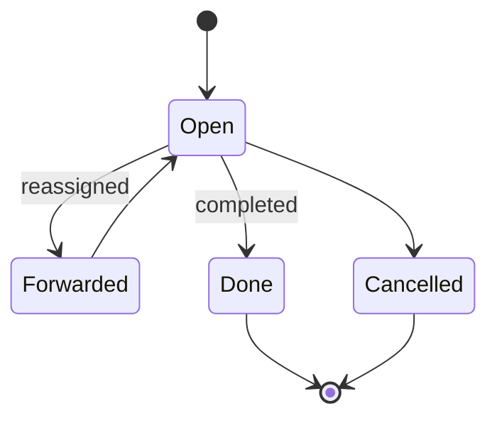
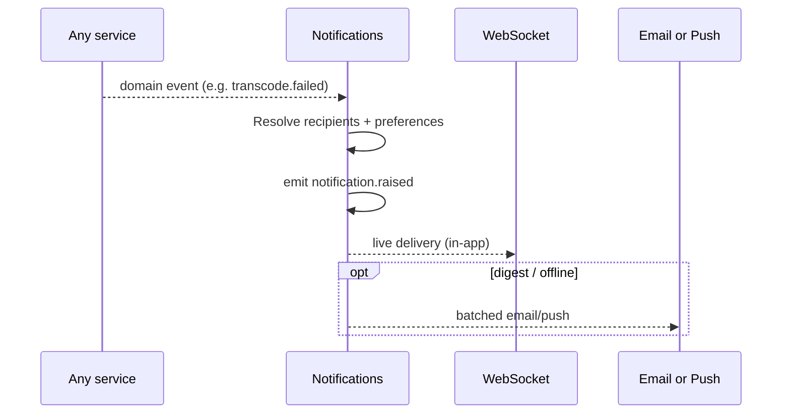

# Notifications & Messaging — Service Specification

> System notifications **and** user↔user/group messaging and tasks — unified because both are
> permission-aware delivery. Summary card:
> [Service Catalog §Notifications](../03-service-catalog.md#notifications--messaging). Template:
> [services/README](README.md#spec-template).

## 1. Purpose & boundaries

This service owns everything that lands in a user's **inbox**: assigned **tasks**, direct and
group **messages**, and **system notifications** (job done, approval needed, mention). It is
unified because tasks, messages, and notifications are all "deliver this to the right people,
respecting permissions, live and/or by digest". Live delivery rides the
[WebSocket service](websocket.md); optional email/push handles digests.

**In scope:** inbox; tasks (assign/forward/complete); direct + group messages; system
notifications with per-user preferences; delivery routing (live via WebSocket, digest via
email/push).

**Out of scope:** *deciding* a task exists ([BMS](bms.md) creates workflow tasks; MAM/MTS/HSM
raise events that become notifications); the live transport itself ([WebSocket](websocket.md));
identity/permissions ([IAM](iam.md)).

## 2. Requirements covered

- [FR-MSG-1…4](../../requirements/05-functional-requirements.md#messaging) — inbox of tasks +
  messages; send/receive/forward to users or groups; notifications for relevant events; live
  via WebSocket + optional email/push digest.
- Delivers tasks from [FR-APP-1](../../requirements/05-functional-requirements.md#approval)
  (review→task) and [FR-BMS-5](../../requirements/05-functional-requirements.md#workflow)
  (human-in-the-loop steps).
- NFR: non-critical to the media path but important to UX
  ([Architecture §8](../02-system-architecture.md#8-failure-and-degradation-model)).

## 3. Domain model

| Entity | Key fields | Store |
|--------|-----------|-------|
| **Message** | id, channelId, from, to (users/groups), body, threadId?, sentAt | Relational |
| **Task** | id, channelId, assignee, kind, subjectRef (assetId/instanceId), state, dueAt, forwardOf? | Relational |
| **Notification** | id, userId, type, subjectRef, read, createdAt | Relational |
| **InboxState** | userId, unreadCounts, lastSeen | Relational + cache |
| **Preference** | userId, per-type channel (live/email/push), digest cadence | Relational |

### 3.1 Task state

## 4. Public API

> **Contracts:** REST → [OpenAPI stub](../openapi/notifications.yaml) · events → [payload schemas](../schemas/).

| Method | Path | Purpose | Authz |
|--------|------|---------|-------|
| `GET` | `/inbox` | Unified inbox — open tasks offered to the caller by name, group or role (resolved at read time), and notifications. ✅ EP-25.1/25.3 | self |
| `GET/POST` | `/messages` | List the caller's messages / send a direct or group message — §13d. ✅ EP-25.4 | `message:send` to send; reading is the caller's own |
| `POST` | `/tasks` | Assign a task by hand to a user, group or role. ✅ EP-25.2 | `task:assign` |
| `GET` | `/tasks/{id}` | One task. ✅ EP-25.2 | a participant, a holder of what it is offered to, or `task:admin` |
| `POST` | `/tasks/{id}/claim` · `/forward` · `/complete` · `/cancel` | Claim (first wins), hand on, complete with an outcome, cancel — §13c. ✅ EP-25.2 | the holder; `task:admin` to reassign or cancel |
| `PATCH` | `/notifications/{id}` | Mark read/unread. ✅ EP-25.5 | self — another's is not found |
| `GET` / `PUT` | `/notification-types` · `/{key}` | The notification-type registry as the channel has it — §13e. ✅ EP-25.5 | read: any caller; write: `config:admin` |
| `GET/PUT` | `/preferences` | The caller's notification preferences — per type on/off (§13f). ✅ EP-25.6 | self |

## 5. Messaging

- **Emits:** `message.sent`, `task.created`, `task.updated`, `notification.raised` — consumed by
  the [WebSocket service](websocket.md) for live delivery.
- **Consumes:** `workflow.task.resolved` (BMS) — a workflow's task closed by MAM's verdict (done,
  EP-22.6) or by its workflow (cancelled: a timeout, or the run failed; EP-22.9).
- **Consumes (to raise notifications):** many — `asset.approved`, `asset.rejected`,
  `workflow.task.created`, `transcode.failed`, `ingest.rejected`, `restore.completed`,
  `checksum.mismatch`, mentions, etc.

## 6. Key flows

### 6.1 Event → notification → live + digest

### 6.2 Task assignment & forwarding
A reviewer assigns media to another user ([FR-APP-1](../../requirements/05-functional-requirements.md#approval))
or BMS creates a workflow task; the assignee sees it in the inbox live, can **forward** it, and
**complete** it — completion signals [BMS](bms.md) where the task came from a workflow.

## 7. Dependencies

- **WebSocket** (live delivery), **IAM** (recipient resolution + permissions), **BMS**
  (workflow tasks), **broker**, **relational store**, optional **SMTP/push provider** (digest;
  external → disabled in air-gapped per [FR-PLat-8](../../requirements/05-functional-requirements.md#platform)).

## 8. Scaling & performance

- **Stateless API + broker-backed delivery**; scale replicas. Fan-in of many event types →
  recipient resolution is the main cost (cache group memberships).
- Node fits (IO-bound). Email/push are async workers.

## 9. Failure modes & degradation

| Failure | Effect | Mitigation |
|---------|--------|-----------|
| Service down | No new inbox items | Non-critical to media path; events are durable and processed on recovery. |
| WebSocket down | No live pop-ups | Items still appear on inbox refresh; digest still sends. |
| Email/push provider down | No digests | Retry/queue; in-app delivery unaffected; disabled entirely when air-gapped. |
| Duplicate event | Duplicate notification | Idempotency keyed on source `messageId` + recipient. |

## 10. Security & data sensitivity

- Recipients resolved via **effective permissions** — a notification must not reveal a resource
  the user can't access; message content is private to participants.
- Email/push is an **external** channel → per-deployment opt-in, off in air-gapped installs.
- Message content and read state are audited minimally (metadata, not necessarily body).

## 11. Configuration

Notification-type catalog + default routing; per-user preferences + digest cadence; email/push
provider (connected deployments only); group-message policies; retention for
messages/notifications.

## 12. Observability

- **Metrics:** notifications raised/delivered, task open/complete/forward rates, inbox unread
  distribution, email/push success, delivery latency.
- **Logs:** task lifecycle, delivery attempts/results.
- **Traces:** source-event correlation id through to delivery.

## 13. Implementation notes

- **Node.js + NestJS/Fastify**; broker consumers for event→notification; async worker for
  email/push (`nodemailer`/provider SDK). Cache group memberships (from IAM) for fast recipient
  fan-out. Reuse the [WebSocket](websocket.md) private-channel model for live delivery — decided
  2026-10-12 (EP-25.7): a private message names its `recipientUserId` and reaches only that user's
  connections ([websocket §5](websocket.md#5-messaging)).

## 13a. As built — EP-25.1, the scaffold and the lifted slice

`apps/notifications`, generated (`nx g service notifications --db --broker`), then given the
reference slice (`reference/notifications-service`) on a real store: an `InboxStore` port with a
sqlite and a Postgres adapter, one conformance suite driven through the service.

- **`workflow.task.created` → a task.** One row per task, keyed by BMS's own task id (derived, so a
  retried BMS activity names the same task): the seen-mark, the row, `task.created` and its
  `audit.recorded` commit together, so a redelivery — or the same task in another message — writes
  nothing twice. The chain continues (`correlationId`, `causationId` = the BMS message).
- **`asset.expired` → re-review due** for the `priorApprover` (`asset.re-review-due`, warning), with
  `notification.raised`; nothing when there was no approver. Preferences are EP-25.6.
- **`GET /inbox`** — the caller's own (no parameter names a user): open tasks oldest-due first, the 50
  newest notifications, the unread count.
- A message that is not the event it claims is thrown to the broker (retried, then dead-lettered).

**Who a task reaches (decided 2026-10-16): resolved at READ time.** A workflow's human step names a
user or a ROLE (the DSL's `assignee`), so `PrincipalKind` gained `role` and `workflow.task.created`
says which (`assigneeKind`; absent = user, what BMS sent before). A task offered to a group or a role
stays ONE row; whose inbox it is in is answered when an inbox is read — the caller's roles and groups
from IAM, cached and dropped on `permissions.changed` / `group.membership.changed` — so a new holder
sees an open task and someone who left stops seeing it; whoever claims it first owns it (25.2).

## 13b. As built — EP-25.3, the inbox resolves roles and groups at read time

`GET /inbox` asks IAM who the caller is as an addressee — `GET /internal/v1/users/{id}/principals`:
their groups, and every role they hold directly or through a group — and lists the open tasks
offered to the caller by name, to any of those groups, or to any of those roles, in the caller's
channel. The call is signed (ADR-0008, amended) with **`iam-read-keys`**, a READ key IAM accepts on
that route alone; it is never routed by the gateway. An unknown or disabled user is nobody (404 →
their own name only).

- **Cached** per user for 30 s, and **forgotten** on `permissions.changed` and
  `group.membership.changed` for that user — a BROADCAST subscription, so every replica drops its
  own copy at once; the TTL only bounds what a broker outage delays. Concurrent reads of one user
  share one request, and an answer that left IAM before a change is not cached after it.
- **IAM away is not a failed read**: the inbox holds what is offered by name and says `partial:
  true`. Without `iam-read-keys` configured it is always so, and the service logs it at start.

Smoke gives the smoke user the `viewer` role through a group, offers a workflow's human step to the
role, and finds the task in the user's inbox through the gateway with `partial: false`.

## 13c. As built — EP-25.2, what people do with tasks (decided 2026-10-16)

| Action | Route | Who |
|---|---|---|
| Assign by hand | `POST /tasks` | `task:assign` in the channel (Editor and above) — to a user, a group or a role |
| Claim | `POST /tasks/{id}/claim` | someone in the group / holding the role it is offered to — **first claim wins** (409 after) |
| Forward | `POST /tasks/{id}/forward` | its holder (assigned by name) — or anyone with `task:admin` (a reassignment) |
| Complete | `POST /tasks/{id}/complete` | its holder, with an `outcome` — never a REVIEW task (below) |
| Cancel | `POST /tasks/{id}/cancel` | `task:admin` — and never a workflow's task, which its workflow ends |
| Read one | `GET /tasks/{id}` | a participant, a holder of what it is offered to, or `task:admin`; anyone else a 404 |

- **Claim first.** A task offered to a group or a role is claimed — it becomes the claimer's by name —
  before it is forwarded or completed, so two people never complete one and the history says who did.
- Every action is a **compare-and-set on the task's `version`** (two claims at once: one 200, one 409 —
  the conformance suite races them on Postgres) and writes the task, `task.updated` (a claim or forward
  is `forwarded`, naming who holds it now) and its `audit.recorded` delta in one transaction.
- **Participants** — every user it was ever assigned to by name, its maker, whoever claimed or acted
  on it — are kept on the task and ride in its audit deltas; the log lets them read its history with
  no permission, `task:audit` reads anyone's (logging-analytics §6.4). A task stored before carries
  none and is read as its first revision.
- A role task cannot be claimed while IAM cannot say who holds the role (503); nothing is written.

Completing a workflow's task moves its workflow (EP-25.8): BMS's completion router consumes
`task.updated` and signals the waiting human step — bms.md §13e.

**A review task** (EP-22.6, decided 2026-10-16) — a workflow's task with a `reviewPointId` — is
closed by MAM's verdict, never completed here: `complete` is a 409 naming the point to give the
verdict at (`POST /assets/{id}/approve` or `/reject` with `reviewPointId`). BMS hears the verdict and
emits `workflow.task.resolved`; this service applies it — the task `done`, the verdict its outcome,
its author `closedBy` and a participant, `task.updated` + `audit.recorded` (`task.resolved`) in one
transaction, the seen-mark with them. A resolution for a task not here yet goes back to the broker
(its creation rides another durable); one for a closed task is a duplicate. bms.md §13f.

**A workflow task CANCELLED** (EP-22.9): `workflow.task.resolved` with `state: cancelled` and a
`reason` (`timeout`, `workflow-ended`) — its step ran out of time, or its run failed while it was
open — closes the task `cancelled` (`closedBy: bms`, no outcome), announced (`task.updated`
cancelled) and audited `task.cancelled`. A task already closed is a duplicate. bms.md §13h.

Not yet: a task's audit history (`task` entity) has no read rule in the log — choosing one is a log
visibility change, reviewed with EP-25.2, which is when people first act on tasks. Live delivery is
EP-25.7; until then `task.created`/`notification.raised` reach the log, not a socket.

## 13d. As built — EP-25.4, messages (decided 2026-10-18)

- **Who may message whom.** With `message:send` in the channel — every starter role a person works
  under carries it (authorization-model §9) — a person may message ANY user and ANY group of their
  channel, a member of it or not. A ROLE is not addressable for chat (422): it is a set of
  permissions, not people one talks to. The channel is the boundary: a message is a row of the
  sender's channel and is read only in it, so an id that names nobody here reaches nobody — no
  lookup of recipients is made, and none could leak whether an id exists.
- **Who reads a group's message: its members WHEN IT IS READ** — a chat room: a member who joins
  reads its history, one who leaves no longer does. Resolved as a role's task is (§13b): the
  reader's groups come from IAM at read time, cached and forgotten on a membership change; IAM
  away, `GET /messages` holds what is the reader's by name — sent by or to them — and says
  `partial: true`.
- **Sending is one transaction** (`POST /messages`, `{ to: [{ kind, id }], body, threadId? }`, at
  most 50 recipients and 4000 characters): the message, a row per recipient (the index a reader is
  found by), `message.sent`, and `audit.recorded` whose delta is the METADATA — who wrote to whom,
  when, in which thread — never the body (§10). Neither the log's `message` entries nor its
  history have a read rule today (`message:read` exists nowhere), so content stays with its
  participants; live delivery is EP-25.7.
- `GET /messages` is the caller's own (no parameter names a user): newest first, keyset on id.

Evidence: `test/messages.test.ts` (a user and a group as recipients — sender, user and members read
it, nobody else, nor another channel; a joiner reads the history and a leaver does not; IAM away is
`partial`; `message:send`, roles refused, bodies bounded; the audit without the body; paging), the
store conformance case on sqlite and Postgres, and smoke on kind.

## 13e. As built — EP-25.5, the notification-type registry and the pipeline (decided 2026-10-18)

**The registry** (configuration §2.2, Tier 1). Code defines the TYPES — the event that raises each,
who it goes to and what they must be able to read, and the `{{slots}}` its titles may use — so a type
no code raises cannot be configured (`UNKNOWN_TYPE`). An operator changes, per channel, what is
theirs: the title per locale (en, ar), the severity, `enabled`, `defaultOn` and `mandatory` (the last
two are what preferences honour, EP-25.6) — `PUT /notification-types/{key}?version=` under
`config:admin`, a compare-and-set on the override's version (0 for the first), audited as
`notification-type` (the log reads it under `config:admin`, as a transcode profile's). A title may
use only the type's slots (422); a slot left empty renders as nothing. `GET /notification-types` is
every caller's: it is what their preferences are about.

**The pipeline** (`src/pipeline.ts`), routed as the product owner decided:

| Event | Type | To |
|---|---|---|
| `asset.approved` (not an automatic one) | `asset.approved` | the asset's creator |
| `asset.rejected` | `asset.rejected` | the asset's creator |
| `asset.expired` | `asset.re-review-due` (mandatory) | whoever approved it last |
| `transcode.failed` | `transcode.failed` | whoever asked for the transcode |
| `message.sent` with `@<userId>` | `message.mention` | that person, if the message is theirs to read |
| `alert.raised` | `alert` (mandatory; the alert's own severity) | everyone holding `ops:read` in the channel |

**An alert is ONE shared notification** for its audience, `ops:read` — resolved when an inbox is
read, as a role's task is (by the reader's own policy, from IAM): someone granted operations later
sees it, someone who lost the grant does not. Each reader's read state is their own
(`shared_notification_reads`); marking it read is theirs only, and someone outside the audience
finds nothing. Holding `ops:read` is the read check — it is what the log reads alerts under. No
`notification.raised` is emitted for it (that event names one user); live delivery is EP-25.7's.

**Every recipient is re-checked** before anything is written: their own policy (IAM's, as for a
request) must let them read the subject — the asset in its category, owned by its creator (MAM's
verdict and expiry events now carry `createdBy` and `categoryPath`), or the message (to them by name,
or to a group they are in now). Someone with no policy — a service id, a user since disabled — is
told nothing; so is a reader narrowed to other categories. `transcode.failed` carries `requestedBy`
but not the category (MTS does not know it), so a category-narrowed requester is not told — the strict
check failing closed. One transaction per event: the seen-mark, each notification (its title rendered
in every locale) and its `notification.raised`. A disabled type raises nothing.

A person marks their own notification read or unread (`PATCH /notifications/{id}`); another's is not
found. Preferences are §13f; live delivery is EP-25.7.

Evidence: `test/pipeline.test.ts` (a verdict to the creator, once, in both locales; an automatic
approval to nobody; the re-check — another category, no policy; a failed transcode to its requester
and not to a service; a mention to readers by name and through a group, not to others nor oneself; the
registry — read by anyone, written under `config:admin`, CAS, unknown types and slots refused, an
override's severity and title applied, a disabled type silent, audited; mark read; an alert to the
holders of `ops:read`, each reading it for themselves, a later holder seeing it), the store
conformance cases on sqlite and Postgres, and smoke on kind (an approval tells its creator, titled as
the channel's registry says; a failed workflow run's alert reaches an `ops:read` holder's inbox).

## 13f. As built — EP-25.6, preferences (decided 2026-10-18)

- **Per type, on or off.** Until a person chooses, a type is its `defaultOn` as their channel has it
  (§13e); a type the channel marks `mandatory` is always on, and turning it off is REFUSED (422
  `MANDATORY`) — never quietly kept. An unknown type is `UNKNOWN_TYPE`.
- `GET /preferences` is the caller's own: every type with `on`, its `defaultOn`, `mandatory`, and
  whether `on` is their own choice (`chosen`). `PUT /preferences?version=` replaces their choices
  whole — a compare-and-set on the version read (0 for the first), so two tabs saving at once is one
  write and a 409 — and is audited (`preference`, the delta of what they chose; no read rule in the
  log, so it is nobody else's).
- **Honoured where each notification is made**: one addressed to a person is not written when they
  have the type off; a SHARED one (an alert, §13e) is written once and filtered when each reader
  reads it — neither shown nor counted — so a reader who turns alerts back on sees them again.
- Delivery channels (email/push) and digests are v2 (notifications-plan §1).

Evidence: `test/preferences.test.ts` (defaults and mandatory types; off → not raised, the rest
unchanged, CAS, audited, back on; mandatory and unknown refused with nothing written; a channel's
`defaultOn: false` and an optional alert turned off by its reader — hidden and uncounted), the store
conformance case on sqlite and Postgres, and smoke on kind.

## 14. Open questions / future

- Threaded conversations / read receipts depth.
- Escalation rules for overdue workflow tasks (SLA-driven re-notify).
- Mobile push app vs. web push only.

---
_Related: [WebSocket](websocket.md) · [BMS](bms.md) · [IAM](iam.md) ·
[Messaging & Data](../04-messaging-and-data.md)._
