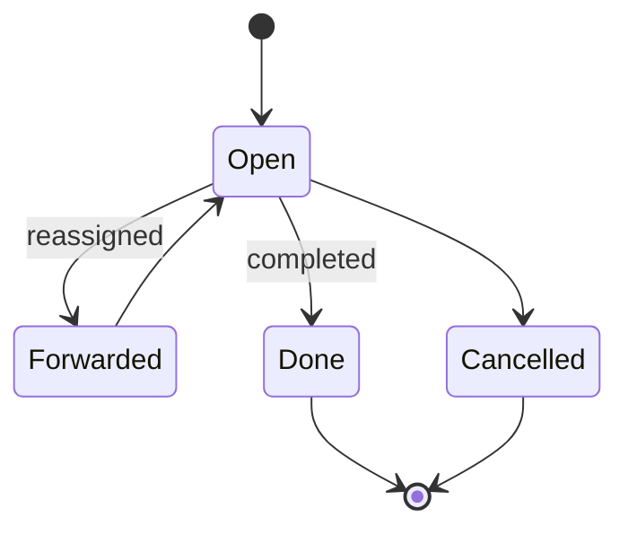
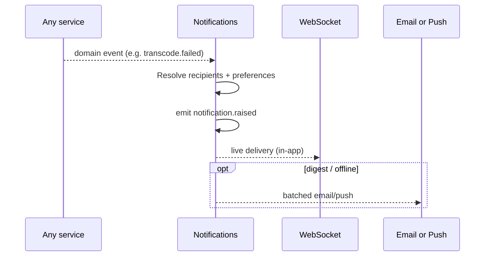

# Notifications & Messaging — Service Specification

> System notifications **and** user↔user/group messaging and tasks — unified because both are
> permission-aware delivery. Summary card:
> [Service Catalog §Notifications](../03-service-catalog.md#notifications--messaging). Template:
> [services/README](README.md#spec-template).

## 1. Purpose & boundaries

This service owns everything that lands in a user's **inbox**: assigned **tasks**, direct and
group **messages**, and **system notifications** (job done, approval needed, mention). It is
unified because tasks, messages, and notifications are all "deliver this to the right people,
respecting permissions, live and/or by digest". Live delivery rides the
[WebSocket service](websocket.md); optional email/push handles digests.

**In scope:** inbox; tasks (assign/forward/complete); direct + group messages; system
notifications with per-user preferences; delivery routing (live via WebSocket, digest via
email/push).

**Out of scope:** *deciding* a task exists ([BMS](bms.md) creates workflow tasks; MAM/MTS/HSM
raise events that become notifications); the live transport itself ([WebSocket](websocket.md));
identity/permissions ([IAM](iam.md)).

## 2. Requirements covered

- [FR-MSG-1…4](../../requirements/05-functional-requirements.md#messaging) — inbox of tasks +
  messages; send/receive/forward to users or groups; notifications for relevant events; live
  via WebSocket + optional email/push digest.
- Delivers tasks from [FR-APP-1](../../requirements/05-functional-requirements.md#approval)
  (review→task) and [FR-BMS-5](../../requirements/05-functional-requirements.md#workflow)
  (human-in-the-loop steps).
- NFR: non-critical to the media path but important to UX
  ([Architecture §8](../02-system-architecture.md#8-failure-and-degradation-model)).

## 3. Domain model

| Entity | Key fields | Store |
|--------|-----------|-------|
| **Message** | id, channelId, from, to (users/groups), body, threadId?, sentAt | Relational |
| **Task** | id, channelId, assignee, kind, subjectRef (assetId/instanceId), state, dueAt, forwardOf? | Relational |
| **Notification** | id, userId, type, subjectRef, read, createdAt | Relational |
| **InboxState** | userId, unreadCounts, lastSeen | Relational + cache |
| **Preference** | userId, per-type channel (live/email/push), digest cadence | Relational |

### 3.1 Task state

## 4. Public API

> **Contracts:** REST → [OpenAPI stub](../openapi/notifications.yaml) · events → [payload schemas](../schemas/).

| Method | Path | Purpose | Authz |
|--------|------|---------|-------|
| `GET` | `/inbox` | Unified inbox (tasks + messages + notifications). | self |
| `GET/POST` | `/messages` | List/send direct or group messages. | `message:send` |
| `GET/POST/PATCH` | `/tasks`, `/tasks/{id}` | Create/list/update; forward or complete. | assignee/creator |
| `PATCH` | `/notifications/{id}` | Mark read/dismiss. | self |
| `GET/PUT` | `/preferences` | Per-user delivery preferences. | self |

## 5. Messaging

- **Emits:** `message.sent`, `task.created`, `task.updated`, `notification.raised` — consumed by
  the [WebSocket service](websocket.md) for live delivery.
- **Consumes (to raise notifications):** many — `asset.approved`, `asset.rejected`,
  `workflow.task.created`, `transcode.failed`, `ingest.rejected`, `restore.completed`,
  `checksum.mismatch`, mentions, etc.

## 6. Key flows

### 6.1 Event → notification → live + digest

### 6.2 Task assignment & forwarding
A reviewer assigns media to another user ([FR-APP-1](../../requirements/05-functional-requirements.md#approval))
or BMS creates a workflow task; the assignee sees it in the inbox live, can **forward** it, and
**complete** it — completion signals [BMS](bms.md) where the task came from a workflow.

## 7. Dependencies

- **WebSocket** (live delivery), **IAM** (recipient resolution + permissions), **BMS**
  (workflow tasks), **broker**, **relational store**, optional **SMTP/push provider** (digest;
  external → disabled in air-gapped per [FR-PLat-8](../../requirements/05-functional-requirements.md#platform)).

## 8. Scaling & performance

- **Stateless API + broker-backed delivery**; scale replicas. Fan-in of many event types →
  recipient resolution is the main cost (cache group memberships).
- Node fits (IO-bound). Email/push are async workers.

## 9. Failure modes & degradation

| Failure | Effect | Mitigation |
|---------|--------|-----------|
| Service down | No new inbox items | Non-critical to media path; events are durable and processed on recovery. |
| WebSocket down | No live pop-ups | Items still appear on inbox refresh; digest still sends. |
| Email/push provider down | No digests | Retry/queue; in-app delivery unaffected; disabled entirely when air-gapped. |
| Duplicate event | Duplicate notification | Idempotency keyed on source `messageId` + recipient. |

## 10. Security & data sensitivity

- Recipients resolved via **effective permissions** — a notification must not reveal a resource
  the user can't access; message content is private to participants.
- Email/push is an **external** channel → per-deployment opt-in, off in air-gapped installs.
- Message content and read state are audited minimally (metadata, not necessarily body).

## 11. Configuration

Notification-type catalog + default routing; per-user preferences + digest cadence; email/push
provider (connected deployments only); group-message policies; retention for
messages/notifications.

## 12. Observability

- **Metrics:** notifications raised/delivered, task open/complete/forward rates, inbox unread
  distribution, email/push success, delivery latency.
- **Logs:** task lifecycle, delivery attempts/results.
- **Traces:** source-event correlation id through to delivery.

## 13. Implementation notes

- **Node.js + NestJS/Fastify**; broker consumers for event→notification; async worker for
  email/push (`nodemailer`/provider SDK). Cache group memberships (from IAM) for fast recipient
  fan-out. Reuse the [WebSocket](websocket.md) private-channel model for live delivery — decided
  2026-10-12 (EP-25.7): a private message names its `recipientUserId` and reaches only that user's
  connections ([websocket §5](websocket.md#5-messaging)).

## 13a. As built — EP-25.1, the scaffold and the lifted slice

`apps/notifications`, generated (`nx g service notifications --db --broker`), then given the
reference slice (`reference/notifications-service`) on a real store: an `InboxStore` port with a
sqlite and a Postgres adapter, one conformance suite driven through the service.

- **`workflow.task.created` → a task.** One row per task, keyed by BMS's own task id (derived, so a
  retried BMS activity names the same task): the seen-mark, the row, `task.created` and its
  `audit.recorded` commit together, so a redelivery — or the same task in another message — writes
  nothing twice. The chain continues (`correlationId`, `causationId` = the BMS message).
- **`asset.expired` → re-review due** for the `priorApprover` (`asset.re-review-due`, warning), with
  `notification.raised`; nothing when there was no approver. Preferences are EP-25.6.
- **`GET /inbox`** — the caller's own (no parameter names a user): open tasks oldest-due first, the 50
  newest notifications, the unread count.
- A message that is not the event it claims is thrown to the broker (retried, then dead-lettered).

**Who a task reaches (decided 2026-10-16): resolved at READ time.** A workflow's human step names a
user or a ROLE (the DSL's `assignee`), so `PrincipalKind` gained `role` and `workflow.task.created`
says which (`assigneeKind`; absent = user, what BMS sent before). A task offered to a group or a role
stays ONE row; whose inbox it is in is answered when an inbox is read — the caller's roles and groups
from IAM, cached and dropped on `permissions.changed` / `group.membership.changed` — so a new holder
sees an open task and someone who left stops seeing it; whoever claims it first owns it (25.2).

## 13b. As built — EP-25.3, the inbox resolves roles and groups at read time

`GET /inbox` asks IAM who the caller is as an addressee — `GET /internal/v1/users/{id}/principals`:
their groups, and every role they hold directly or through a group — and lists the open tasks
offered to the caller by name, to any of those groups, or to any of those roles, in the caller's
channel. The call is signed (ADR-0008, amended) with **`iam-read-keys`**, a READ key IAM accepts on
that route alone; it is never routed by the gateway. An unknown or disabled user is nobody (404 →
their own name only).

- **Cached** per user for 30 s, and **forgotten** on `permissions.changed` and
  `group.membership.changed` for that user — a BROADCAST subscription, so every replica drops its
  own copy at once; the TTL only bounds what a broker outage delays. Concurrent reads of one user
  share one request, and an answer that left IAM before a change is not cached after it.
- **IAM away is not a failed read**: the inbox holds what is offered by name and says `partial:
  true`. Without `iam-read-keys` configured it is always so, and the service logs it at start.

Smoke gives the smoke user the `viewer` role through a group, offers a workflow's human step to the
role, and finds the task in the user's inbox through the gateway with `partial: false`.

## 13c. As built — EP-25.2, what people do with tasks (decided 2026-10-16)

| Action | Route | Who |
|---|---|---|
| Assign by hand | `POST /tasks` | `task:assign` in the channel (Editor and above) — to a user, a group or a role |
| Claim | `POST /tasks/{id}/claim` | someone in the group / holding the role it is offered to — **first claim wins** (409 after) |
| Forward | `POST /tasks/{id}/forward` | its holder (assigned by name) — or anyone with `task:admin` (a reassignment) |
| Complete | `POST /tasks/{id}/complete` | its holder, with an `outcome` |
| Cancel | `POST /tasks/{id}/cancel` | `task:admin` — and never a workflow's task, which its workflow ends |
| Read one | `GET /tasks/{id}` | a participant, a holder of what it is offered to, or `task:admin`; anyone else a 404 |

- **Claim first.** A task offered to a group or a role is claimed — it becomes the claimer's by name —
  before it is forwarded or completed, so two people never complete one and the history says who did.
- Every action is a **compare-and-set on the task's `version`** (two claims at once: one 200, one 409 —
  the conformance suite races them on Postgres) and writes the task, `task.updated` (a claim or forward
  is `forwarded`, naming who holds it now) and its `audit.recorded` delta in one transaction.
- **Participants** — every user it was ever assigned to by name, its maker, whoever claimed or acted
  on it — are kept on the task and ride in its audit deltas; the log lets them read its history with
  no permission, `task:audit` reads anyone's (logging-analytics §6.4). A task stored before carries
  none and is read as its first revision.
- A role task cannot be claimed while IAM cannot say who holds the role (503); nothing is written.

Completing a workflow's task does not yet move its workflow — that is EP-25.8.

Not yet: a task's audit history (`task` entity) has no read rule in the log — choosing one is a log
visibility change, reviewed with EP-25.2, which is when people first act on tasks. Live delivery is
EP-25.7; until then `task.created`/`notification.raised` reach the log, not a socket.

## 14. Open questions / future

- Threaded conversations / read receipts depth.
- Escalation rules for overdue workflow tasks (SLA-driven re-notify).
- Mobile push app vs. web push only.

---
_Related: [WebSocket](websocket.md) · [BMS](bms.md) · [IAM](iam.md) ·
[Messaging & Data](../04-messaging-and-data.md)._
